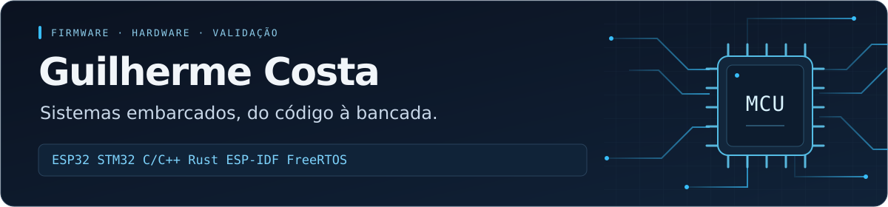

**Firmware em microcontroladores · Comunicação entre dispositivos · Validação em hardware**

[LinkedIn](https://www.linkedin.com/in/guilherme-costa-a00463291/) · [E-mail](mailto:guizeracostasilva@outlook.com) · [Repositórios](https://github.com/GuilhermeDevSoftware?tab=repositories)

## Sobre mim

Sou **Guilherme Costa**, estudante de **Engenharia de Computação na Unilins**, com foco em **firmware, sistemas embarcados e eletrônica**.

Desenvolvo projetos com **ESP32 e ESP-IDF em C/C++** e **STM32 com Rust embarcado**. Meu trabalho nos projetos envolve aquisição de sinais, configuração de periféricos, comunicação entre dispositivos e investigação de falhas em bancada. Uso **Python e MATLAB** como apoio à coleta de dados, automação de testes e análise dos resultados.

Gosto de conectar o código ao comportamento do circuito: ler datasheets, medir sinais, observar temporização e registrar evidências do funcionamento.

**Busco uma oportunidade de entrada em firmware, sistemas embarcados ou pesquisa e desenvolvimento.**

## Projetos de firmware e hardware

| Projeto | Implementação e validação |
| --- | --- |
| **[LoRa Link Analyzer](https://github.com/GuilhermeDevSoftware/Lora-Link-Analyzer)** | **STM32 + Rust / ESP32 + ESP-IDF.** Comunicação SPI com rádios SX1278, protocolo com sequência e ACK, retransmissões e tratamento de duplicatas. Coleta serial em Python e comparação de RSSI, SNR e recepção no MATLAB. **Versão inicial concluída e validada.** |
| **[Telemetria GPS com ESP32](https://github.com/GuilhermeDevSoftware/esp32-gps-telemetry-idf)** | **ESP-IDF, C e FreeRTOS.** Aquisição por UART/NMEA, processamento no dispositivo, gravação offline em microSD, MQTT e caminho alternativo por HTTP. **Testes de campo com power bank e validação da UART com analisador lógico.** |
| **[Gateway Ambiental](https://github.com/GuilhermeDevSoftware/GATEWAY-AMBIENTAL-ESP32-ARDUINO)** | **Arduino + ESP32 + W5500.** Aquisição de sensores e comunicação UART entre placas; Ethernet com Wi-Fi reserva, MQTT, fila offline em microSD, tarefas FreeRTOS, watchdog e OTA. **Projeto concluído e documentado.** |
| **[Analisador de Sistemas Embarcados](https://github.com/GuilhermeDevSoftware/embedded-systems-analyzer)** | **ESP32 + ESP-IDF.** Laboratório em evolução para estudar GPIO, temporização, UART e diagnóstico de sinais. Reúne firmware, documentação e capturas de bancada para acompanhar a validação do hardware. |
| **[Cálculo de CPF em Assembly 8051](https://github.com/GuilhermeDevSoftware/Calculo_CPF_Assembly)** | **Assembly e arquitetura de microcontroladores.** Estudo de registradores, operações aritméticas, memória e controle de fluxo no 8051, com execução em simulador. |
| **[Gerador de pulsos em FPGA](https://github.com/GuilhermeDevSoftware/GERADOR-PULSO-CLOCK)** | **Tang Nano 20K e Verilog.** Geração de pulso temporizado com botão, debounce, sincronização e detecção de borda. **Funcionamento validado na placa.** |

## TCC · Monitoramento óptico de energia

Desenvolvo um sistema com **ESP32 e C++/ESP-IDF** para realizar a leitura óptica externa de um medidor digital de energia, integrando **eletrônica de condicionamento de sinal e firmware de contagem**.

- **Bancada:** emissor e fototransistor infravermelhos, comparador LM393 e entrada digital do ESP32.
- **Resultado obtido:** **20 pulsos enviados e 20 detectados** em um ensaio controlado de emissão e recepção.
- **Próximas etapas:** melhorar a robustez da detecção e validar a leitura no medidor real.

O repositório **Monitor-Energia permanece privado durante o desenvolvimento acadêmico**.

## Base técnica aplicada nos projetos

| Área | Tecnologias e prática |
| --- | --- |
| **Firmware** | C/C++, Rust embarcado, ESP-IDF, FreeRTOS, GPIO, temporização e organização de tarefas |
| **Hardware** | ESP32, STM32 Nucleo-F446RE, Arduino, 8051 e FPGA Tang Nano 20K |
| **Interfaces e comunicação** | UART, SPI, I²C, LoRa ponto a ponto, Ethernet/W5500, Wi-Fi, MQTT e HTTP |
| **Instrumentação e análise** | Multímetro, fonte de bancada, analisador lógico, Python, CSV e MATLAB |
| **Ambiente de desenvolvimento** | Linux/WSL, Git, GCC, Cargo, probe-rs e ST-LINK |

## Experiência em bancada

Realizei estágio na **Águia Rádio Comando**, com atividades de manutenção e desenvolvimento de placas de rádio comando, soldagem e substituição de componentes **SMD**, medições e investigação de falhas em circuitos.

Essa vivência complementa meus projetos de firmware com prática em **eletrônica, instrumentação e diagnóstico de hardware**.

## Estudos em andamento

- **Linux embarcado:** geração de imagens e experimentação com Buildroot.
- **Firmware:** aprofundamento em sistemas de tempo real, drivers e comunicação CAN.
- **IA em dispositivos:** fundamentos de visão computacional e aplicações em detecção de falhas.

Tenho interesse em seguir para o **mestrado e a pesquisa aplicada**, aproximando sistemas embarcados, experimentação e problemas reais de engenharia.

---

**Contato profissional:** [LinkedIn](https://www.linkedin.com/in/guilherme-costa-a00463291/) · [guizeracostasilva@outlook.com](mailto:guizeracostasilva@outlook.com)
